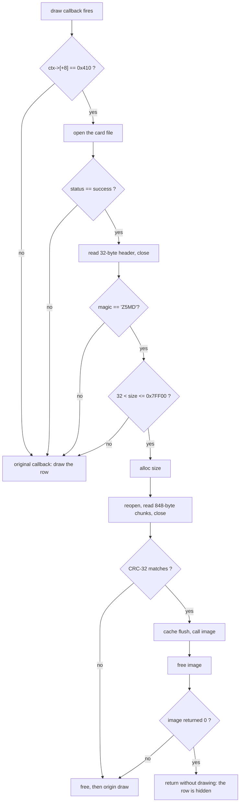

# The firmware loader

The patched camera reads a `.Z5M` file from the card and runs it. That is the
whole point of the patch: a later feature can be a card file instead of a
reflash. This document describes exactly what the patched firmware does and what
that implies for anyone writing a module.

## Where the code lives

The patch does not add a task, a menu entry or a stub. It hijacks the **draw
callback of the module row** and appends a loader to the end of the firmware
image, so the firmware's own code keeps running unchanged until someone opens
that row.

| Item | Value |
| --- | --- |
| Firmware image base | `0x10020000` |
| Stock image size | `0x02100238` bytes (34,603,576) |
| Appended card path | image base + `0x02100238` |
| Appended loader code | image base + `0x02100248` (`0x12120248`) |
| Patched literal | image offset `0x492224`, holds the original callback |
| Original callback | `0x104b1f59` |
| Module row id | `0x410` |

The patch writes the address of the loader into the callback literal, so the row
now calls the loader. Everything else in the image is untouched, and the two
CRC levels are resealed.

## What triggers it

The firmware calls the row's draw callback with a context object. The loader
reads `ctx->[+8]` - the element id - and compares it with `0x410`:

## The steps in detail

1. **Save everything.** All eleven registers and the return address are pushed,
   and a 176-byte frame is allocated. The callback enters with four live
   arguments; the loader preserves them so the original callback still works.
2. **Open the card file.** A file object is filled in on the frame, the path
   address is the appended string, and the file is opened.
3. **Read the header before allocating.** 32 bytes are read, the file is closed.
   Closing first is deliberate: the file service and the memory service are then
   never busy at the same time, which is what made an earlier version freeze.
4. **Check the header.** Offset `+0` must be the magic `Z5MD` (`0x444D355A`),
   offset `+20` must be a size in `(32, 0x7FF00]`. Offset `+12` is the entry
   point, used later as `image + offset`.
5. **Allocate and read.** The image is allocated from the system heap, the file is
   opened again, and the image is read in **848-byte chunks** - the firmware's own
   read granularity. The file is closed again.
6. **Verify.** The 32-bit value at `image + 24` is read out and the field is
   zeroed; a CRC-32 (polynomial `0xEDB88320`) is computed over the whole image and
   compared with that value. A mismatch frees the image and draws the row.
7. **Call.** The instruction cache is flushed (`dsb`, `mcr p15,0,rX,c7,c5,0`,
   `isb`), then the entry is called with a context structure on the frame:

   | Field | Value |
   | --- | --- |
   | `+0` | magic `Z5CT` (`0x5443355A`) |
   | `+4` | image address |
   | `+8` | image size |
   | `+12` | `1` |

8. **Free, always.** As soon as the image returns, it is freed. Whatever the
   module needs to outlive the call must be somewhere else.
9. **Decide the row.** If the image returned `0`, the loader returns without
   calling the original callback, which hides the row. Any other value falls
   through to the original callback and the row is drawn normally.

## Failure is quiet

Every failure path - no card, bad magic, bad size, read error, bad CRC - frees
what it allocated and calls the original callback. The row simply draws as
usual. A missing or corrupt file cannot wedge the menu.

## What this means for a module

* it runs **once per redraw** and its image is freed afterwards, so statics are
  reset every time;
* it must not hand the firmware a pointer into its own image;
* it must not free a pointer the firmware keeps;
* it may keep state in the heap and find it again on the next call;
* it should return quickly: the menu waits for the callback to return;
* returning `0` hides the row, which is how a module replaces the row's own
  drawing instead of sitting next to it.
